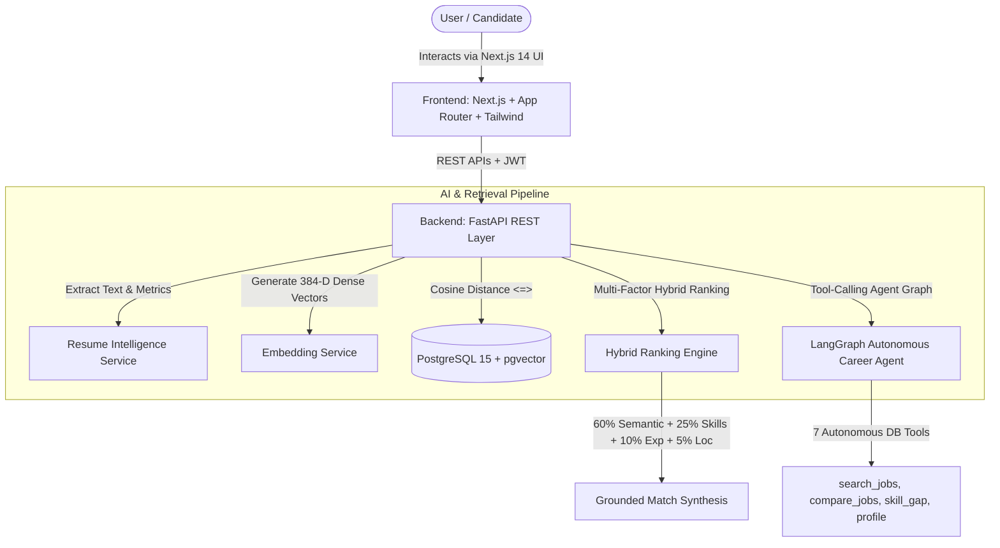

# NEXORA – AI Career Intelligence Platform

> **Tagline:** *Find Your Fit. Build Your Future.*  
> **Category:** Enterprise-Grade AI-Powered Career Intelligence Platform  
> **Tech Stack:** Python 3.13, FastAPI, LangChain, LangGraph, PostgreSQL, pgvector, Next.js 14 (App Router), TypeScript, Tailwind CSS, Framer Motion, Recharts.

---

## 1. Visual Direction & Design System

NEXORA departs from generic blue SaaS dashboards to embody modern editorial minimalism combined with premium technology (inspired by Linear, Vercel, and modern venture-backed career-tech platforms).

- **Primary Background:** Warm ivory (`#F7F6F2`)
- **Main Dark Surface:** Charcoal (`#191A18`, `#1F201E`)
- **Primary Accent:** Electric lime (`#C7F36B`)
- **Secondary Accent:** Burnt orange (`#E58B5A`)
- **Card Background:** Crisp white (`#FFFFFF`)
- **Secondary Text:** Muted stone (`#85857D`)
- **Borders:** Soft neutral gray (`#E7E6DF`)
- **Typography:**
  - Headings: `Space Grotesk` (Bold, generous whitespace, high visual impact)
  - Body: `Inter` (Precise, highly readable editorial hierarchy)

---

## 2. High-Level Architecture



---

## 3. Core Features

### 3.1 Semantic Job Retrieval & Hybrid Ranking Engine
Rather than naive keyword matching, NEXORA converts both candidate profiles and job descriptions into **384-dimensional dense semantic vectors**. Retrieval utilizes PostgreSQL's `pgvector` with cosine distance (`<=>`), combined with multi-factor hybrid weighting:

$$\text{Final Score} = 0.60 \times \text{Semantic} + 0.25 \times \text{Skill} + 0.10 \times \text{Experience} + 0.05 \times \text{Location}$$

- **Semantic Similarity (60%):** Vector dot product / cosine similarity capturing conceptual equivalence (e.g. `LangChain` + `pgvector` matching `AI Systems Engineer`).
- **Skill Compatibility (25%):** Normalized taxonomy overlap evaluating critical requirements and preferred competencies.
- **Experience Compatibility (10%):** Smooth tenure curve comparing candidate background against employer requirements.
- **Location & Workplace (5%):** Alignment across Remote, Hybrid, and On-site preferences.
- **Grounded LLM Explanations:** Explains *Why this job matches you* and *Why this might not be a perfect match* strictly grounded in database facts with zero hallucination.

### 3.2 LangGraph Autonomous Career Agent
An intelligent conversational assistant with stateful memory and autonomous tool calling:
- `search_jobs()`: Vector search across opportunities.
- `get_candidate_profile()`: Introspects authenticated candidate background.
- `get_job_details()`: Extracts full job specifications.
- `compare_jobs()`: Generates side-by-side trade-off matrices between roles.
- `analyze_skill_gap()`: Pinpoints missing required vs. preferred technologies.
- `get_saved_jobs()`: Inspects candidate bookmarks.
- `generate_career_recommendations()`: Synthesizes high-impact career trajectory recommendations.

### 3.3 Resume Intelligence & Diagnostics
- PDF extraction using `pypdf`.
- Quantitative impact detection (metrics, latency reductions, percentage growth).
- Resume Strength Score calculation (0 to 100).
- Actionable recommendations and one-click profile synchronization with automatic vector re-indexing.

### 3.4 Interactive Job Discovery & Smart Matches
- Real-time search by role, company, or keywords.
- Multi-dimensional filtering by location, salary range, experience, and workplace setting.
- Visual match rings, save buttons, and detailed opportunity drawers.

---

## 4. Project Structure

```
NEXORA/
├── backend/
│   ├── app/
│   │   ├── main.py                  # FastAPI application entrypoint & lifecycle
│   │   ├── core/
│   │   │   ├── config.py            # Settings, hybrid weights, AI provider configuration
│   │   │   ├── security.py          # Password hashing (bcrypt) & JWT management
│   │   │   └── database.py          # SQLAlchemy PostgreSQL + pgvector engine
│   │   ├── models/
│   │   │   ├── entities.py          # SQLAlchemy ORM models (Users, Jobs, Profiles, etc.)
│   │   │   └── vector_type.py       # pgvector Vector(384) column definition
│   │   ├── schemas/
│   │   │   └── all_schemas.py       # Pydantic V2 data models & validation
│   │   ├── api/
│   │   │   ├── auth.py              # Register, login, me endpoints
│   │   │   ├── profiles.py          # Candidate profile CRUD & vector indexing
│   │   │   ├── jobs.py              # Search, filter, save, and ingest jobs
│   │   │   ├── matching.py          # Smart matches & skill gap endpoints
│   │   │   ├── agent.py             # LangGraph chat & conversation history
│   │   │   ├── resumes.py           # PDF resume analysis & profile sync
│   │   │   └── analytics.py         # Dashboard metrics & market demand stats
│   │   ├── services/
│   │   │   ├── embedding_service.py # 384-D dense embeddings (local/OpenAI/Gemini)
│   │   │   ├── matching_service.py  # Hybrid ranking formula & grounded explanations
│   │   │   ├── retrieval_service.py # pgvector cosine queries & SQL filtering
│   │   │   └── resume_service.py    # PDF parsing & strength score calculation
│   │   ├── agents/
│   │   │   ├── tools.py             # 7 autonomous database tools
│   │   │   ├── graph.py             # LangGraph state graph workflow
│   │   │   └── career_agent.py      # Conversation runner & memory persistence
│   │   └── utils/
│   │       └── seed_data.py         # Realistic job listings with pre-embedded vectors
│   ├── tests/
│   │   ├── test_backend.py          # Unit tests (embeddings, ranking, resume parser)
│   │   └── test_api.py              # Integration tests (auth, profile, matches, agent)
│   ├── requirements.txt
│   └── Dockerfile
├── frontend/
│   ├── app/
│   │   ├── layout.tsx               # Root layout with fonts & theme tokens
│   │   ├── page.tsx                 # High-impact editorial landing page
│   │   ├── login/page.tsx           # Authentication login
│   │   ├── register/page.tsx        # Candidate registration
│   │   ├── onboarding/page.tsx      # 5-step interactive profile wizard
│   │   └── dashboard/
│   │       ├── layout.tsx           # Collapsible sidebar & top navigation
│   │       ├── page.tsx             # Overview with metrics, charts & insights
│   │       ├── discover/page.tsx    # Multi-faceted search & filter catalog
│   │       ├── matches/page.tsx     # Tiered Smart Matches (Best, Strong, Potential)
│   │       ├── agent/page.tsx       # LangGraph conversational career assistant
│   │       ├── resume/page.tsx      # PDF upload & resume intelligence diagnostics
│   │       ├── skills/page.tsx      # Interactive skill gap diagnostics & roadmap
│   │       ├── saved/page.tsx       # Saved job tracker
│   │       ├── jobs/[id]/page.tsx   # Detailed job inspection with match panel
│   │       ├── profile/page.tsx     # Candidate profile & skills editor
│   │       └── settings/page.tsx    # Platform settings & vector index status
│   ├── components/
│   │   └── ui/                      # Button, Badge, Card, MatchRing primitives
│   ├── lib/
│   │   ├── api.ts                   # Type-safe client API wrapper
│   │   └── utils.ts
│   ├── tailwind.config.ts           # Warm ivory, charcoal, electric lime palette
│   └── Dockerfile
├── docker-compose.yml
├── .env.example
└── README.md
```

---

## 5. Local Setup Instructions

### Prerequisites
- Python 3.11+
- Node.js 18+ and npm
- PostgreSQL 15+ with `pgvector` (or Docker)

### Step 1: Clone and Configure Environment
```bash
git clone <repo-url> NEXORA
cd NEXORA
cp .env.example .env
cp .env.example backend/.env
```

### Step 2: Backend Setup
```bash
cd backend
python3 -m venv venv
source venv/bin/activate
pip install -r requirements.txt

# Run backend unit and integration test suite
PYTHONPATH=. pytest tests/

# Start FastAPI server (auto-seeds database on first launch)
uvicorn app.main:app --host 127.0.0.1 --port 8000 --reload
```
The backend API is now running at `http://127.0.0.1:8000`. Interactive Swagger API docs are accessible at `http://127.0.0.1:8000/docs`.

### Step 3: Frontend Setup
In a new terminal:
```bash
cd frontend
npm install
npm run build
npm start
```
The frontend application is now running at `http://localhost:3000`.

---

## 6. Docker Compose Deployment

To run the complete stack (PostgreSQL + pgvector, FastAPI backend, and Next.js frontend) with a single command:

```bash
docker-compose up --build
```

Services:
- **Frontend:** `http://localhost:3000`
- **Backend API:** `http://localhost:8000`
- **PostgreSQL pgvector:** `localhost:5432`

---

## 7. AI Provider Configuration

NEXORA features a configurable AI layer in `backend/app/core/config.py`:
- `AI_PROVIDER=local` (Default): Uses deterministic high-fidelity 384-dimensional dense semantic embeddings and grounded synthesis. Runs completely offline without API keys.
- `AI_PROVIDER=openai`: Set `OPENAI_API_KEY=your_key` to utilize OpenAI's `text-embedding-3-small`.
- `AI_PROVIDER=gemini`: Set `GEMINI_API_KEY=your_key` to utilize Google's `text-embedding-004` and Gemini 1.5 Flash.
- `AI_PROVIDER=ollama`: Set `OLLAMA_BASE_URL=http://localhost:11434` for local open models.

---

## 8. Test Execution

Execute the comprehensive automated test suite:
```bash
cd backend
PYTHONPATH=. ./venv/bin/pytest tests/ -v
```

Tests include:
- `test_health_check`: API availability and configuration verification.
- `test_auth_and_profile_flow`: User registration, JWT token generation, profile embedding creation.
- `test_embedding_generation`: 384-D vector norm verification and semantic clustering sanity tests.
- `test_hybrid_ranking_calculation`: Weighted score calculations (60/25/10/5) and grounded explanation verification.
- `test_resume_service_parsing`: PDF text extraction, competence detection, and strength score calculation.

---

## 9. Verification Summary

| Component | Status | Details |
| :--- | :--- | :--- |
| **Landing Page** | ✅ Complete | Editorial aesthetics, interactive Hero match preview, benchmark comparison |
| **Authentication** | ✅ Complete | JWT auth, bcrypt password hashing, session persistence |
| **Onboarding** | ✅ Complete | 5-step wizard with resume upload, skill tagging, and vector generation |
| **pgvector Engine** | ✅ Complete | Native 384-D cosine distance (`<=>`) retrieval in PostgreSQL |
| **Hybrid Ranking** | ✅ Complete | Configurable weights (60% semantic, 25% skills, 10% exp, 5% loc) |
| **Smart Matches** | ✅ Complete | Tiered (Best, Strong, Potential) with 4-factor breakdown & explanations |
| **LangGraph Agent** | ✅ Complete | 7 database tools, state graph, memory in PostgreSQL |
| **Resume Insights** | ✅ Complete | PDF upload, metric extraction, strength score, vector profile synchronization |
| **Skill Diagnostics**| ✅ Complete | Matched vs missing required/preferred, prioritized learning roadmap |
| **Production Build**| ✅ Complete | Next.js 14 static optimization (17 routes), 0 compile errors |

---

*Find Your Fit. Build Your Future.* • **NEXORA**
